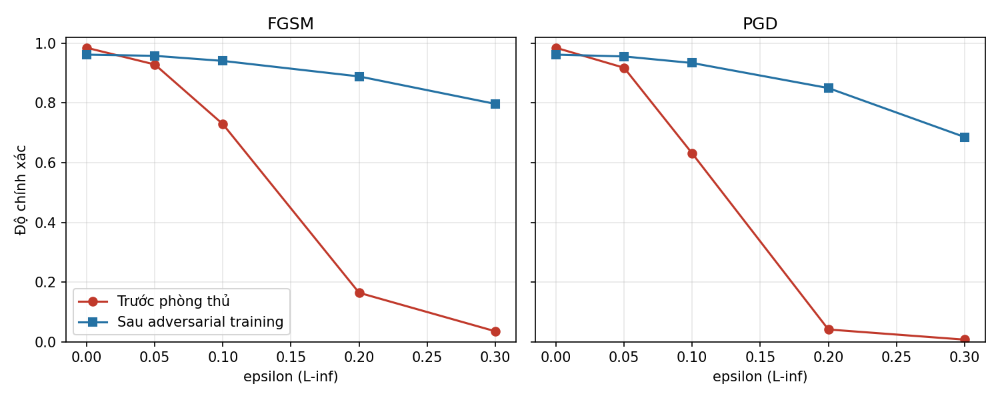

# Báo cáo Thành viên 2 - Tấn công né tránh & đối kháng (Adversarial Evasion)

## 1. Mục tiêu và phạm vi
- Hệ thống mục tiêu: `target_systems/classifier` (SimpleCNN, ảnh 28x28, 10 lớp).
- Dữ liệu: MNIST; 1000 ảnh kiểm thử.
- Ánh xạ chuẩn: MITRE ATLAS AML.T0015 (Evade ML Model) / AML.T0043 (Craft Adversarial Data); OWASP ML Top 10 - ML01 Input Manipulation Attack.

## 2. Phương pháp
- **Red Team:** FGSM và PGD (20 bước, bước = ε/4, 1 lần khởi tạo ngẫu nhiên) của IBM ART, chuẩn L∞, ảnh giới hạn trong [0, 1]. Mức ε: 0.05, 0.1, 0.2, 0.3.
- **Blue Team:** Adversarial Training - mỗi batch 50% ảnh sạch + 50% ảnh PGD (ε = 0.3, 10 bước), 20 epoch, huấn luyện mô hình mới từ đầu.

## 3. Kết quả
Độ chính xác trên ảnh sạch: trước phòng thủ **98.5%**, sau phòng thủ **96.2%** (đánh đổi: mô hình bền hơn thường kém hơn một chút trên ảnh sạch).

| Tấn công | ε | Trước phòng thủ | Sau phòng thủ | Phục hồi (điểm %) |
|---|---|---|---|---|
| FGSM | 0.05 | 92.9% | 95.8% | +2.9 |
| FGSM | 0.1 | 72.9% | 94.1% | +21.2 |
| FGSM | 0.2 | 16.4% | 88.9% | +72.5 |
| FGSM | 0.3 | 3.5% | 79.7% | +76.2 |
| PGD | 0.05 | 91.8% | 95.6% | +3.8 |
| PGD | 0.1 | 63.1% | 93.4% | +30.3 |
| PGD | 0.2 | 4.1% | 85.0% | +80.9 |
| PGD | 0.3 | 0.7% | 68.6% | +67.9 |



## 4. Nhận xét
- Chưa phòng thủ: độ chính xác giảm từ 98.5% xuống 91.8% (PGD, ε=0.05) và 0.7% (PGD, ε=0.3); PGD thấp hơn hoặc bằng FGSM ở 4/4 mức ε.
- Phòng thủ có hiệu quả rõ nhất ở: PGD ε=0.2 (+80.9 điểm %).
- Ở ε=0.3, độ chính xác sau phòng thủ: FGSM 79.7%, PGD 68.6%. Adversarial training **không** bảo vệ được ở mọi mức nhiễu: nhiễu càng lớn thì lợi ích càng giảm.
- Hạn chế: mô hình nhỏ, tập kiểm thử nhỏ (1000 ảnh) nên số liệu dao động vài điểm %; chưa thử tấn công thích nghi (adaptive attack) hay các thuật toán mạnh hơn (AutoAttack, C&W).

## 5. Cách tái lập
```
python member_modules/member2_adversarial_evasion/assess_evasion.py
python member_modules/member2_adversarial_evasion/defense_adversarial_training.py
python member_modules/member2_adversarial_evasion/generate_report.py
```
Biến môi trường tùy chọn: `M2_N_TRAIN` (mặc định 10000), `M2_N_TEST` (1000), `M2_EPOCHS` (20).
Số liệu được ghi vào `shared_logging/audit_results.json` (module `member2_evasion`, `member2_defense`).
